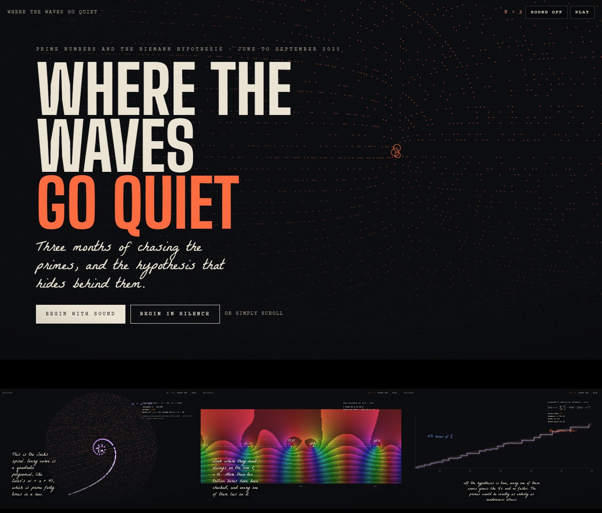

# primes

**Prime numbers as an interference of waves, and what that has to do with the Riemann hypothesis.**

Live site: **[primes.joycemalik.com](https://primes.joycemalik.com)**

[](https://primes.joycemalik.com)

Between June and September 2025 I tried many ways to "break or prove" the Riemann hypothesis. I started from one intuition: *primes are the silence left behind when the waves of smaller primes interfere.* This repository holds all of that work: about 170 scripts, 15 notebooks, 1,100+ figures, MIDI songs and animations. It is organised by idea and published as an interactive "journal" that shows each experiment working and checks each claim honestly.

**Short answer:** nothing here proves or disproves RH, and no computation can. The prime wave turns out to be exactly the Sieve of Eratosthenes. The intuition becomes exact in one place: Riemann's 1859 explicit formula, where the waves come from the zeros of ζ(s). The site shows that formula live.

## What's inside

```
primes/
├── site/                      the web app (static, no build): index.html + assets/
├── research/                  all experiments, numbered in the order they were explored
│   ├── 01-prime-wave-sieve/          the founding idea: numbered series prime01–22, detectors, CRT theory, notebooks
│   ├── 02-physics-inspired-wave-models/  chaos attractor, standing-wave resonance, radial waves
│   ├── 03-complex-plane/             Z(n) on the unit circle, spirals, convergence, GPU prime hunts
│   ├── 04-bit-pair-sequences/        6k±1 bit pairs and the GPT / Gemini recurrences
│   ├── 05-hex-sequence-puzzle/       the FA57A5BA… hex string, Game of Life, day 11
│   ├── 06-prime-music/               MIDI encodings of primes and the generated songs
│   ├── 07-gaps-walks-spirals/        gap statistics, factorisation graphs, day 18 (528 radial plots, 2D/3D walks, sonification)
│   ├── 08-machine-learning/          transformers, GPU tests, day 19 nth-prime models and symbolic regression
│   ├── 09-prime-matrix/              eigenvalues of the N×N prime matrix (day 17)
│   └── 10-factorials-and-gamma/      Γ-function factorials (day 37)
├── archive/                   older backups, empty placeholder files, and the reorganisation log + undo script
├── REORGANIZATION.md          every original path → new path
└── vercel.json                serves site/ on Vercel
```

Every research folder has its own `README.md` listing each file's original name, new name, last-edited date and what it does. Every script starts with a short header comment giving the same information. File names keep their original numbers (`prime01_…`, `v01_…`, `07_…`), so the order of the experiments is preserved.

## The site

The site is a period physics journal: one sheet per part, numbered equations, engraved plates, and referee's notes in the margins. Every figure is computed live in the browser:

- the prime wave and its false positives, and why they vanish exactly at P > √N
- Z(n) on the unit circle, the Sacks and golden-angle spirals, the 3D prime walk
- the partial-sum spiral of ζ(s) and a hand-tinted domain colouring of ζ (Borwein series, checked against mpmath)
- Riemann's explicit formula rebuilding the prime staircase from the first 1,000 zeros
- GUE spacing of the zeros, the critical line, and Robin's inequality (σ(n) < e^γ n ln ln n for n > 5040 ⇔ RH), which you can test on any n
- a referee's report re-checking every claim in the notebooks, and a searchable inventory of every file

Run it locally: open `site/index.html`, or run `python -m http.server` inside `site/`.

## Running the research code

```
python -m venv .venv
.venv\Scripts\activate          # Windows   (source .venv/bin/activate on macOS/Linux)
pip install -r research/requirements.txt
```

Most scripts run on their own, e.g. `python research/01-prime-wave-sieve/detectors/prime_wave_detector.py`. A few print emoji, so on Windows set `PYTHONIOENCODING=utf-8`.

## Not in this repository

Kept locally because they are too large for GitHub or can be regenerated (see `.gitignore`):

| File | Size | Regenerate with |
|---|---|---|
| `day19-…/blackbox_artifacts/best_model.joblib` | 212 MB | `17_nth_prime_model_comparison.ipynb` |
| `day18-…/radial_plots_animation.gif`, `…2.gif`, `…3.mp4` | 121, 100, 53 MB | `g2_frames_to_animation.py`, `g3_frames_to_consistent_video.py` |
| `day18-…/radial_plots_generator/`, `radial_plot_gen2/` (800 frames) | 467 MB | `v71` / `v73` / `v79` scripts |
| `day18-…/interactive_3d_walks/Interactive_3D_PrimeWalk_1000000.html` | 57 MB | `v53_3d_rotation_walk_interactive.py` |
| `day19-…/prime_sequences_n10000_m6.png` | 52 MB | `19_shifted_prime_sequences.py` |

## Deploying to Vercel

Import this repository in Vercel. The root `vercel.json` publishes the `site/` folder with no build step, so no settings are needed. Then add the domain `primes.joycemalik.com` under Project → Settings → Domains, and create a DNS record `CNAME primes → cname.vercel-dns.com` at your DNS provider.
